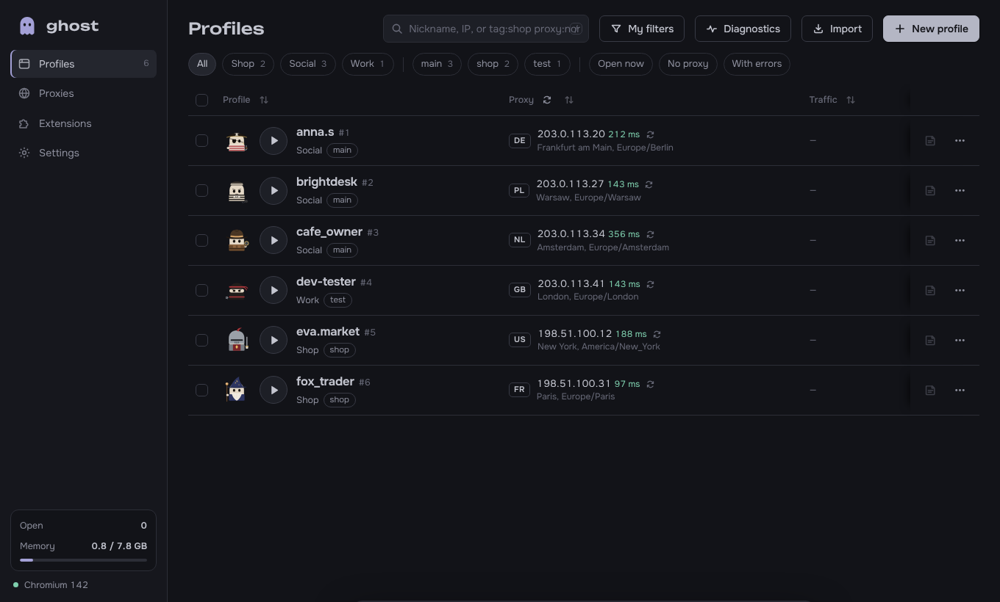
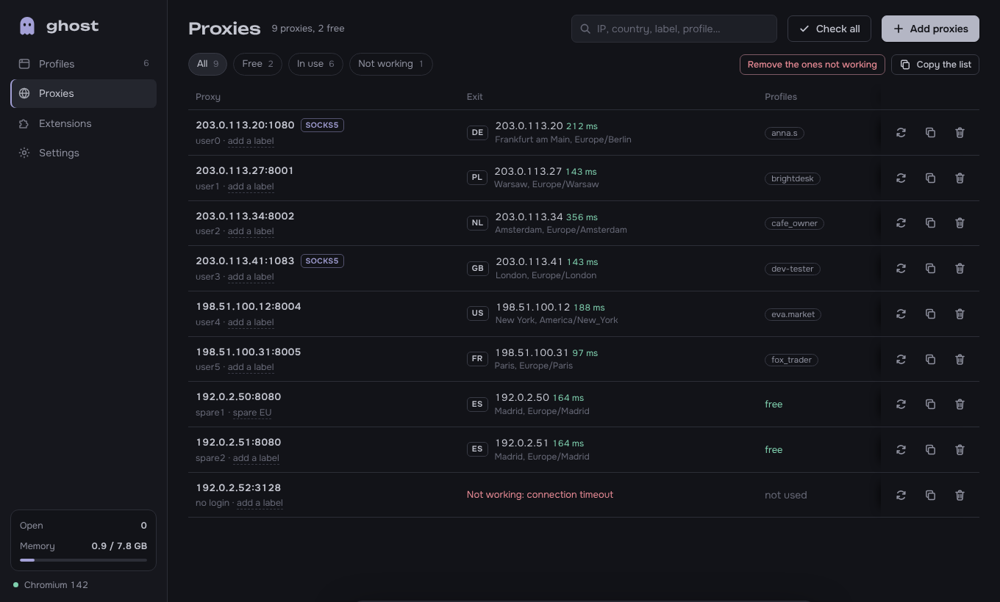
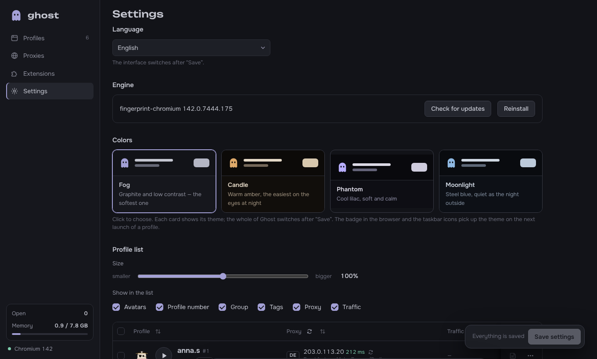

  

<h1 align="center">Ghost</h1>

  An antidetect browser for Windows: many browser profiles side by side, each with its own fingerprint, proxy and cookies.

  <b>English</b> · <a href="README.uk.md">Українська</a> · <a href="README.ru.md">Русский</a>

  <a href="https://github.com/qustixx/ghost-anty/releases/latest/download/Ghost-Setup.exe"><b>⬇ Download Ghost-Setup.exe</b></a>
  &nbsp;·&nbsp;
  <a href="https://t.me/ghostbrowser_bot"><b>Buy a key in Telegram</b></a>

## What Ghost does

Every profile in Ghost is a separate browser. Sites see a different computer in each one: its own fingerprint, IP address, time zone, language, cookies and extensions. You can keep dozens of accounts open at once and they never meet.

- **Profiles:** create one or many at once; groups, tags, statuses, notes, saved filters, templates, cloning, bulk actions, and a trash you can restore from.
- **Own window per profile:** every open profile has its own taskbar button with its own icon and name.
- **Fingerprint:** profiles run on [fingerprint-chromium](https://github.com/adryfish/fingerprint-chromium), a Chromium build that changes the fingerprint inside the browser itself, not with a script a site could notice.
  - One seed per profile drives WebGL, audio, fonts, ClientRects and memory, so they stay consistent with each other.
  - You choose the Windows version, CPU cores and window size.
  - The time zone and language follow the proxy's country, and WebRTC never shows your real IP.
- **Proxies:**
  - HTTP, SOCKS5 and SOCKS4, with or without a login. Paste a whole list in any common format or load a .txt / .csv file.
  - A check shows the IP, country, city and ping of every proxy. New profiles take free proxies from the list by themselves.
  - Optional [WebShare](https://www.webshare.io/) integration pulls in the proxies of your account.
  - Ghost warns you about a proxy shared by two profiles and about an exit country that changed since the last launch.
- **Data:** cookie import (Cookie-Editor, EditThisCookie, Dolphin, AdsPower JSON or Netscape `cookies.txt`), start pages, bookmarks, site permissions. Chrome Web Store extensions are installed once and turned on per profile.
- **Traffic counter:** how much traffic each profile used, now and in total.
- **Housekeeping:** export and import of profiles with their logins (to move to another PC), diagnostics, an error log, disk usage with cache cleanup, a launch queue.
- **Comfort:** English, Ukrainian and Russian; four dark themes; a tray icon and Windows notifications.

| | |
|---|---|
|  |  |
|  |  |

## Prices

One plan with everything in it and **no limit on profiles**. One key works on one computer.

| Period | Price |
|---|---|
| 1 week | **$10** |
| 1 month | **$25** |
| 3 months | **$65** |
| 12 months | **$199** |

You buy a key in the Telegram bot **[@ghostbrowser_bot](https://t.me/ghostbrowser_bot)**: pick a period, pay, and the bot sends you the key. The bot also renews a key and shows how long yours has left.

## How to start

1. **Download** [Ghost-Setup.exe](https://github.com/qustixx/ghost-anty/releases/latest/download/Ghost-Setup.exe) and run it.
   - Windows may show *"Windows protected your PC"*. Click **More info**, then **Run anyway**.
   - No administrator rights are needed: Ghost installs for your Windows user only.
2. **Open Ghost.** On the first start it downloads its browser engine (about 150 MB) by itself and shows the progress.
3. **Enter your key.** Ghost asks for it once. Buy one in [@ghostbrowser_bot](https://t.me/ghostbrowser_bot) if you don't have one yet.
4. **Create a profile**, give it a proxy, and press ▶.

To update, download the new Ghost-Setup.exe and install it over the old one. Your profiles and settings stay. Ghost also tells you itself when a new version is out.

**Requirements:** Windows 10 or 11, 64-bit, and an internet connection (the key is checked online; Ghost keeps working up to 3 days without one).

## Questions

**Where are my profiles kept?** On your computer only, in `%LOCALAPPDATA%\GhostBrowser`. Nothing about your profiles, cookies or proxies is sent anywhere.

**What happens when the key runs out?** Ghost locks until you renew it in the bot. Your profiles are kept and come back as they were.

**I got a new computer.** In [@ghostbrowser_bot](https://t.me/ghostbrowser_bot) open **Мої ключі** (My keys) → **Перенести на інший ПК** (Move to another PC), then enter the key on the new computer. You can do this once every 30 days. Export your profiles in Ghost first so you can import them there.

**How do I uninstall it?** *Settings → Apps → Ghost* in Windows. Your profiles stay unless you choose to delete them too.

## License

Ghost is proprietary software, © 2026 geek7, all rights reserved. Its source code is not published. See [LICENSE.md](LICENSE.md).

Ghost is a tool for keeping browser identities apart: running several of your own accounts, testing sites, protecting your privacy. Follow the law and the rules of the sites you use.
