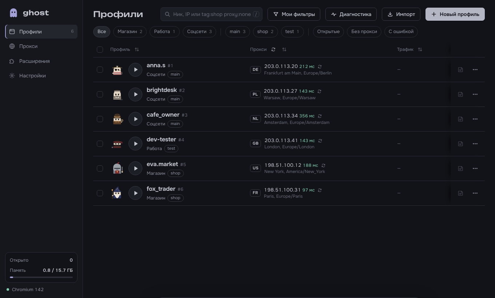
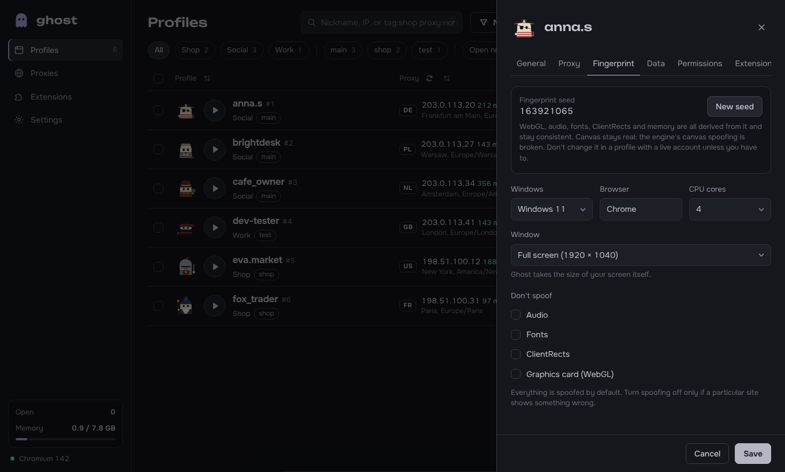
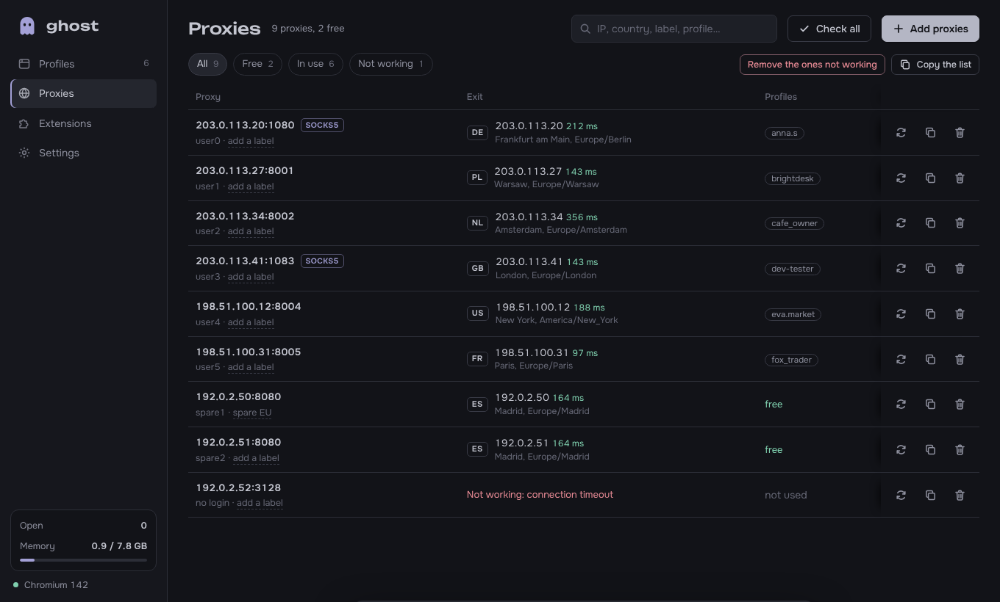
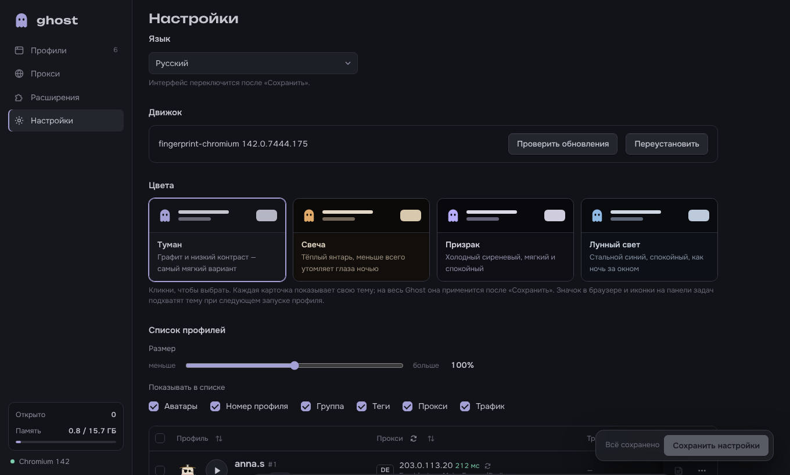
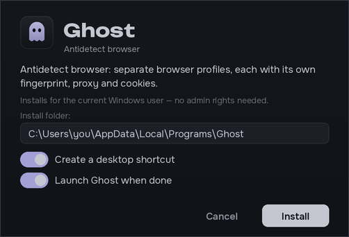

<p align="center">
  
</p>

<h1 align="center">Ghost</h1>

<p align="center">
  Антидетект-браузер для Windows и Linux: много профилей браузера одновременно, у каждого свой отпечаток, прокси и cookies.
</p>

<p align="center">
  <a href="README.md">English</a> · <a href="README.uk.md">Українська</a> · <b>Русский</b>
</p>

<p align="center">
  <a href="https://github.com/qustixx/ghost-anty/releases/latest/download/Ghost-Setup.exe"><b>⬇ Скачать для Windows</b></a>
  &nbsp;·&nbsp;
  <a href="https://github.com/qustixx/ghost-anty/releases/latest/download/Ghost-linux-x64.tar.gz"><b>⬇ Скачать для Linux</b></a>
  &nbsp;·&nbsp;
  <a href="https://t.me/ghostbrowser_bot"><b>Купить ключ в Telegram</b></a>
</p>



## Что умеет Ghost

Каждый профиль в Ghost — отдельный браузер. Сайты видят в каждом другой компьютер: свой отпечаток, IP-адрес, часовой пояс, язык, cookies и расширения. Можно держать открытыми десятки аккаунтов одновременно, и они никак не пересекаются.

- **Профили:** создание по одному или сразу нескольких; группы, теги, статусы, заметки, сохранённые фильтры, шаблоны, клонирование, массовые действия и корзина с восстановлением.
- **Отдельное окно для каждого профиля:** у каждого открытого профиля своя кнопка на панели задач со своей иконкой и названием.
- **Отпечаток:** профили работают на [fingerprint-chromium](https://github.com/adryfish/fingerprint-chromium) — сборке Chromium, которая подменяет отпечаток внутри самого браузера, а не скриптом, который сайт мог бы заметить.
  - Один seed на профиль задаёт WebGL, аудио, шрифты, ClientRects и память, поэтому они согласованы между собой.
  - Версию Windows, ядра процессора и размер окна выбираешь сам.
  - Часовой пояс и язык подстраиваются под страну прокси, а WebRTC не показывает твой настоящий IP.
- **Прокси:**
  - HTTP, SOCKS5 и SOCKS4, с логином или без. Вставь целый список в любом распространённом формате или загрузи файл .txt / .csv.
  - Проверка показывает IP, страну, город и пинг каждого прокси. Новые профили сами берут свободные прокси из списка.
  - По желанию — интеграция с [WebShare](https://www.webshare.io/), которая подтягивает прокси из твоего аккаунта.
  - Ghost предупреждает, если один прокси стоит в двух профилях или страна выхода изменилась с прошлого запуска.
- **Данные:** импорт cookies (JSON из Cookie-Editor, EditThisCookie, Dolphin, AdsPower или Netscape `cookies.txt`), стартовые страницы, закладки, разрешения сайтов. Расширения из Chrome Web Store ставятся один раз и включаются отдельно в каждом профиле.
- **Счётчик трафика:** сколько трафика потратил каждый профиль — сейчас и всего.
- **Обслуживание:** экспорт и импорт профилей вместе с логинами (чтобы перенести на другой ПК), диагностика, журнал ошибок, место на диске и очистка кэша, очередь запуска.
- **Удобство:** русский, украинский и английский языки; четыре тёмные темы; иконка в трее и уведомления Windows.

| | |
|---|---|
|  |  |
|  |  |

## Цены

Один тариф, в котором есть всё, и **без ограничения количества профилей**. Один ключ работает на одном компьютере.

| Срок | Цена |
|---|---|
| 1 неделя | **$10** |
| 1 месяц | **$25** |
| 3 месяца | **$65** |
| 12 месяцев | **$199** |

Ключ покупается в Telegram-боте **[@ghostbrowser_bot](https://t.me/ghostbrowser_bot)**: выбираешь срок, оплачиваешь, и бот присылает ключ. Там же ключ продлевается и видно, сколько ему ещё осталось.

## Как начать

### На Windows

1. **Скачай** [Ghost-Setup.exe](https://github.com/qustixx/ghost-anty/releases/latest/download/Ghost-Setup.exe) и запусти его.
   - Windows может показать *«Система Windows защитила ваш компьютер»*. Нажми **Подробнее**, затем **Выполнить в любом случае**.
   - Права администратора не нужны: Ghost ставится только для твоего пользователя Windows.
2. **Открой Ghost.** При первом запуске он сам скачает свой движок браузера (около 150 МБ) и покажет прогресс.
3. **Введи ключ.** Ghost попросит его один раз. Если ключа ещё нет, купи его в [@ghostbrowser_bot](https://t.me/ghostbrowser_bot).
4. **Создай профиль**, дай ему прокси и нажми ▶.

Чтобы обновиться, скачай новый Ghost-Setup.exe и установи его поверх старого. Профили и настройки сохранятся. Ghost и сам подскажет, когда выйдет новая версия.

### На Linux

1. **Скачай** [Ghost-linux-x64.tar.gz](https://github.com/qustixx/ghost-anty/releases/latest/download/Ghost-linux-x64.tar.gz).
2. Открой терминал в папке с файлом и выполни:
   ```bash
   tar xzf Ghost-linux-x64.tar.gz && ./ghost/install.sh
   ```
   sudo не нужен: Ghost ставится в `~/.local/opt/ghost`, появляется в меню программ и добавляет команду `ghost`.
   - На Ubuntu 23.10 и новее он может один раз попросить пароль, чтобы включить sandbox браузера. Этот шаг можно пропустить через Ctrl+C: Ghost уже установлен.
3. Открой Ghost из меню программ, введи ключ и дальше всё как на Windows.

Чтобы обновиться, распакуй новый архив и снова выполни `./ghost/install.sh`. Чтобы удалить Ghost, выполни `./ghost/uninstall.sh`.

**Что нужно:** Windows 10 или 11 (64-бит) или 64-битный Linux (Ubuntu 22.04+, Debian 12+ или новее) и интернет (ключ проверяется онлайн; без интернета Ghost работает до 3 дней).

## Вопросы

**Где хранятся мои профили?** Только на твоём компьютере, в `%LOCALAPPDATA%\GhostBrowser` на Windows или в `~/.local/share/ghost-browser` на Linux. Профили, cookies и прокси никуда не отправляются.

**Что будет, когда ключ закончится?** Ghost заблокируется, пока не продлишь ключ в боте. Профили никуда не денутся и вернутся такими, какими были.

**У меня новый компьютер.** В [@ghostbrowser_bot](https://t.me/ghostbrowser_bot) открой **Мої ключі** (Мои ключи) → **Перенести на інший ПК** (Перенести на другой ПК) и введи ключ на новом компьютере. Так можно делать раз в 30 дней. Сначала экспортируй профили в Ghost, чтобы импортировать их на новом ПК.

**Как удалить Ghost?** В Windows: *Параметры → Приложения → Ghost*. Профили останутся, если не выберешь удалить и их.

## Лицензия

Ghost — проприетарная программа, © 2026 geek7, все права защищены. Исходный код не публикуется. См. [LICENSE.md](LICENSE.md).

Ghost — инструмент, чтобы разделять браузерные личности: вести несколько своих аккаунтов, тестировать сайты, защищать приватность. Соблюдай закон и правила сайтов, которыми пользуешься.
