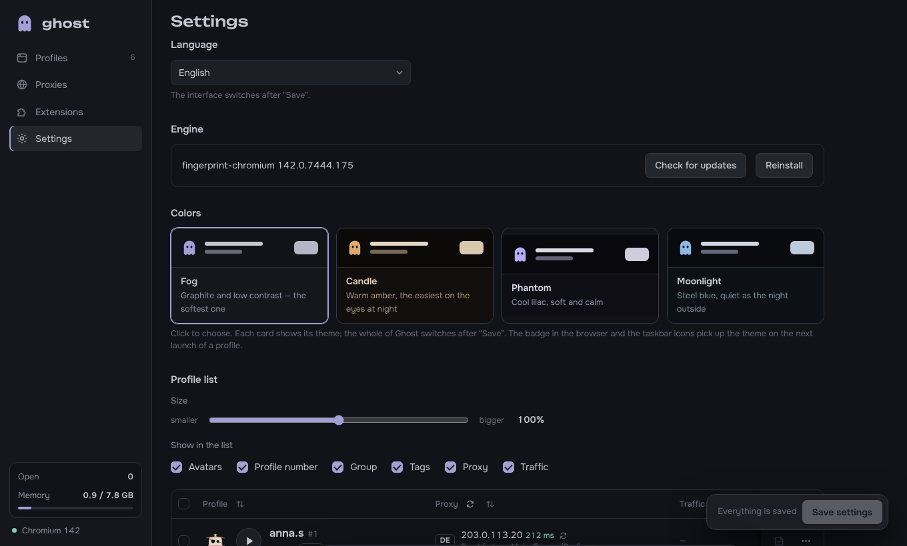
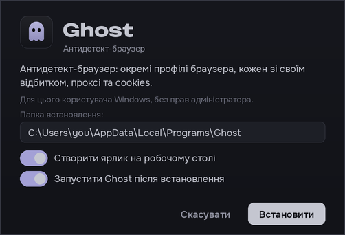

<p align="center">
  
</p>

<h1 align="center">Ghost</h1>

<p align="center">
  Антидетект-браузер для Windows і Linux: багато профілів браузера одночасно, у кожного свій відбиток, проксі й cookies.
</p>

<p align="center">
  <a href="README.md">English</a> · <b>Українська</b> · <a href="README.ru.md">Русский</a>
</p>

<p align="center">
  <a href="https://github.com/qustixx/ghost-anty/releases/latest/download/Ghost-Setup.exe"><b>⬇ Завантажити для Windows</b></a>
  &nbsp;·&nbsp;
  <a href="https://github.com/qustixx/ghost-anty/releases/latest/download/Ghost-linux-x64.tar.gz"><b>⬇ Завантажити для Linux</b></a>
  &nbsp;·&nbsp;
  <a href="https://t.me/ghostbrowser_bot"><b>Купити ключ у Telegram</b></a>
</p>


## Що вміє Ghost

Кожен профіль у Ghost — окремий браузер. Сайти бачать у кожному інший комп'ютер: свій відбиток, IP-адресу, часовий пояс, мову, cookies і розширення. Можна тримати відкритими десятки акаунтів одночасно, і вони ніяк не перетинаються.

- **Профілі:** створення по одному або одразу кількох; групи, теги, статуси, нотатки, збережені фільтри, шаблони, клонування, масові дії та кошик із відновленням.
- **Окреме вікно для кожного профілю:** кожен відкритий профіль має свою кнопку на панелі задач зі своєю іконкою й назвою.
- **Відбиток:** профілі працюють на [fingerprint-chromium](https://github.com/adryfish/fingerprint-chromium) — збірці Chromium, яка підміняє відбиток усередині самого браузера, а не скриптом, який сайт міг би помітити.
  - Один seed на профіль задає WebGL, аудіо, шрифти, ClientRects і пам'ять, тож вони узгоджені між собою.
  - Версію Windows, ядра процесора й розмір вікна обираєш сам.
  - Часовий пояс і мова підлаштовуються під країну проксі, а WebRTC не показує твій справжній IP.
- **Проксі:**
  - HTTP, SOCKS5 і SOCKS4, з логіном або без. Встав цілий список у будь-якому поширеному форматі або завантаж файл .txt / .csv.
  - Перевірка показує IP, країну, місто й пінг кожного проксі. Нові профілі самі беруть вільні проксі зі списку.
  - За бажанням — інтеграція з [WebShare](https://www.webshare.io/), яка підтягує проксі з твого акаунта.
  - Ghost попереджає, якщо один проксі стоїть у двох профілях або країна виходу змінилась від минулого запуску.
- **Дані:** імпорт cookies (JSON з Cookie-Editor, EditThisCookie, Dolphin, AdsPower або Netscape `cookies.txt`), стартові сторінки, закладки, дозволи сайтів. Розширення з Chrome Web Store ставляться один раз і вмикаються окремо в кожному профілі.
- **Лічильник трафіку:** скільки трафіку витратив кожен профіль — зараз і загалом.
- **Обслуговування:** експорт та імпорт профілів разом із логінами (щоб перенести на інший ПК), діагностика, журнал помилок, місце на диску й очищення кешу, черга запуску.
- **Зручність:** українська, російська й англійська мови; чотири темні теми; іконка в треї та сповіщення Windows.

| | |
|---|---|
|  |  |
|  |  |

## Ціни

Один тариф, у якому є все, і **без обмеження кількості профілів**. Один ключ працює на одному комп'ютері.

| Строк | Ціна |
|---|---|
| 1 тиждень | **$10** |
| 1 місяць | **$25** |
| 3 місяці | **$65** |
| 12 місяців | **$199** |

Ключ купується в Telegram-боті **[@ghostbrowser_bot](https://t.me/ghostbrowser_bot)**: обираєш строк, оплачуєш, і бот надсилає ключ. Там же ключ продовжується і видно, скільки йому ще лишилось.

## Як почати

### На Windows

1. **Завантаж** [Ghost-Setup.exe](https://github.com/qustixx/ghost-anty/releases/latest/download/Ghost-Setup.exe) і запусти його.
   - Windows може показати *«Windows захистив ваш ПК»*. Натисни **Докладніше**, потім **Усе одно запустити**.
   - Права адміністратора не потрібні: Ghost ставиться лише для твого користувача Windows.
2. **Відкрий Ghost.** Під час першого запуску він сам завантажить свій двигун браузера (близько 150 МБ) і покаже прогрес.
3. **Введи ключ.** Ghost попросить його один раз. Якщо ключа ще немає, купи його в [@ghostbrowser_bot](https://t.me/ghostbrowser_bot).
4. **Створи профіль**, дай йому проксі й натисни ▶.

Щоб оновитися, завантаж новий Ghost-Setup.exe і встанови його поверх старого. Профілі й налаштування збережуться. Ghost і сам підкаже, коли вийде нова версія.

### На Linux

1. **Завантаж** [Ghost-linux-x64.tar.gz](https://github.com/qustixx/ghost-anty/releases/latest/download/Ghost-linux-x64.tar.gz).
2. Відкрий термінал у папці з файлом і виконай:
   ```bash
   tar xzf Ghost-linux-x64.tar.gz && ./ghost/install.sh
   ```
   sudo не потрібен: Ghost ставиться в `~/.local/opt/ghost`, з'являється в меню програм і додає команду `ghost`.
   - На Ubuntu 23.10 і новіших він може один раз попросити пароль, щоб увімкнути sandbox браузера. Цей крок можна пропустити через Ctrl+C: Ghost уже встановлено.
3. Відкрий Ghost з меню програм, введи ключ і далі все як на Windows.

Щоб оновитися, розпакуй новий архів і знову виконай `./ghost/install.sh`. Щоб видалити Ghost, виконай `./ghost/uninstall.sh`.

**Що потрібно:** Windows 10 або 11 (64-біт) чи 64-бітний Linux (Ubuntu 22.04+, Debian 12+ або новіші) та інтернет (ключ перевіряється онлайн; без інтернету Ghost працює до 3 днів).

## Питання

**Де зберігаються мої профілі?** Лише на твоєму комп'ютері, у `%LOCALAPPDATA%\GhostBrowser` на Windows або в `~/.local/share/ghost-browser` на Linux. Профілі, cookies і проксі нікуди не надсилаються.

**Що буде, коли ключ закінчиться?** Ghost заблокується, доки не продовжиш ключ у боті. Профілі нікуди не зникнуть і повернуться такими, як були.

**У мене новий комп'ютер.** У [@ghostbrowser_bot](https://t.me/ghostbrowser_bot) відкрий **Мої ключі** → **Перенести на інший ПК** і введи ключ на новому комп'ютері. Так можна робити раз на 30 днів. Спершу експортуй профілі в Ghost, щоб імпортувати їх на новому ПК.

**Як видалити Ghost?** У Windows: *Параметри → Програми → Ghost*. Профілі лишаться, якщо не обереш видалити і їх.

## Ліцензія

Ghost — власницька програма, © 2026 geek7, усі права захищені. Вихідний код не публікується. Див. [LICENSE.md](LICENSE.md).

Ghost — інструмент, щоб розділяти браузерні особистості: вести кілька своїх акаунтів, тестувати сайти, захищати приватність. Дотримуйся закону й правил сайтів, якими користуєшся.
